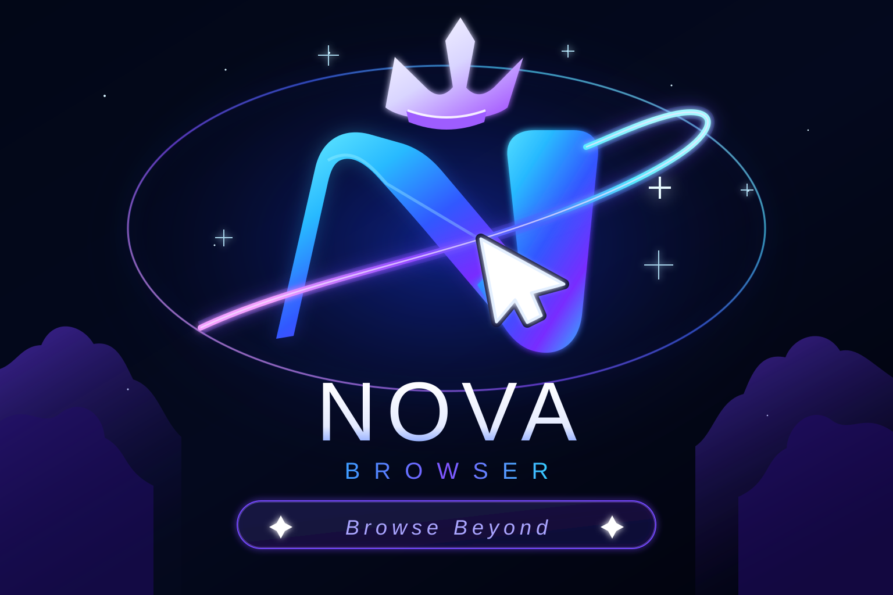

# Android TV Browser — existing NOVA app

  <a href="https://nova-tv-browser.onrender.com">Open web preview</a> ·
  <a href="https://github.com/gagancodeX/nova-browser/releases">Android releases</a> ·
  <a href="https://github.com/gagancodeX/nova-browser/actions/workflows/build-native-apk.yml">APK build workflow</a>

This repository contains a native Android TV browser and a separate web preview. The Android application is the actual browser experience; the Render-hosted preview is a browser-style UI and cannot replace a Chromium engine.

## Target device

- Xiaomi Mi TV 4A 32-inch
- Android 6 / API 23 minimum
- Landscape TV screens
- Remote-first navigation
- Low-memory devices (3-tab limit by default)
- No Play Store required for manual USB installation

## Native Android features

### Browsing and search
- Address bar detects URLs versus search queries.
- Search providers: Google, Bing, DuckDuckGo, Brave Search, Yahoo, Ecosia, Startpage, Qwant, Mojeek, Yandex, Naver, Kagi and custom URL templates.
- Same-tab HTTP/HTTPS navigation.
- Legacy-WebView handling for `target=_blank` links and JavaScript `window.open`.
- Back, forward, reload, home and up to three tabs.
- Browser error, SSL and HTTP status feedback.

### TV controls and interface
- TV-first dashboard and quick launch.
- Remote pointer with arrow/crosshair/ring styles, size, speed, colour and outline.
- D-pad move, OK click and Back navigation.
- TV and desktop user-agent modes based on the actual installed WebView version.
- Bookmarks, browsing history and user-created website channels.

### Media and downloads
- HTML5 video controls and fullscreen custom-view handling where the device WebView supports them.
- Android Download Manager integration.
- APK downloads passed to the Android package installer.
- App discovery links and GitHub release update checking.

### Privacy and settings
- Optional common-ad-domain filter with per-site allowlist.
- Private tabs that skip history saving and disable form-data saving/cache use.
- Cursor settings, search engine settings, zoom, find-in-page, share/copy URL, engine diagnostics and clear-data actions.

## Known technical limits

This is a native **Android WebView browser**, not a bundled Chromium fork.

- Website rendering depends on the WebView provider and Chromium version installed by the TV firmware.
- Android 6 is outside the current WebView support track. Some current sites, especially YouTube, may reject its old engine.
- The private-tab mode does not isolate WebView cookies from normal tabs; it should not be described as fully cookie-isolated incognito.
- The ad filter is a small domain list, not a full EasyList/uBlock Origin engine.
- DRM streaming depends on device DRM/Widevine, codecs and firmware.
- The app has not yet been fully validated on the physical Xiaomi TV.
- Puffin-style cloud rendering is not deployed. That requires a separate secure remote Chromium backend and low-latency streaming service; a local APK/WebView cannot provide it by itself.

## Web preview on Render

Live preview: https://nova-tv-browser.onrender.com

Render service:
- Repository: `gagancodeX/nova-browser`
- Branch: `main`
- Publish directory: `web`
- Auto-deploy: enabled

The web preview uses iframes for page display. Search engines and several sites block iframe embedding, so it cannot behave like a full browser. Use the native Android APK for actual TV browsing.

## Build and APK delivery

Every Android source change triggers GitHub Actions:
https://github.com/gagancodeX/nova-browser/actions/workflows/build-native-apk.yml

- A debug APK artifact is built and uploaded for 30 days, even when release-signing secrets are not configured.
- A stable-signed APK and GitHub Release are published only after the four signing secrets are configured.
- The in-app updater expects the release asset `NOVA-TV-Browser.apk` and its `.sha256` checksum.
- Debug APKs may need the previous app uninstalled before installation if their signing key differs.

### Stable release signing — one-time setup

Follow [docs/ANDROID-RELEASE-SIGNING.md](docs/ANDROID-RELEASE-SIGNING.md).

Add these repository Actions secrets:
- `NOVA_KEYSTORE_BASE64`
- `NOVA_KEYSTORE_PASSWORD`
- `NOVA_KEY_ALIAS`
- `NOVA_KEY_PASSWORD`

The private keystore must be backed up securely and must never be committed to this public repository. The first APK signed by the permanent key requires a one-time reinstall if the currently installed version was signed with a different debug key. Future releases signed by the same key can be installed over the existing application.

## Repository structure

- `android/` — native Android TV application
- `web/` — static browser-style preview
- `assets/nova-brand.svg` — scalable repository brand artwork
- `.github/workflows/build-native-apk.yml` — APK build and optional stable-release workflow
- `docs/ANDROID-RELEASE-SIGNING.md` — signing setup and migration steps

## Development rule

Build, compile and test in small steps. A successful Gradle build is not proof of full website compatibility. Validate actual navigation, playback, downloads, remote controls, low-memory behaviour and Android 6 installation on the target TV before declaring the browser fully working.
